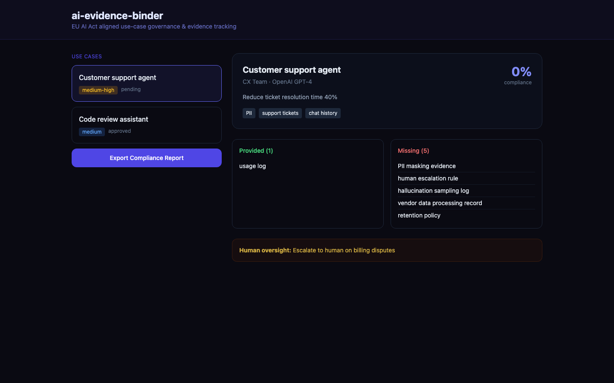

# ai-evidence-binder

> Bind AI use cases to value, risk, data, owner, human oversight, and evidence — EU AI Act aligned.



## Features

- Use case registry with risk classification
- Compliance scoring per use case
- Missing evidence detection (PII masking, escalation rules, sampling logs)
- Export compliance report

## Quick Start

```bash
npm install
npm run dev      # http://localhost:3104
npm test
```

## License

MIT
